# Volt Wave Tech

Volt Wave Tech is a full-stack commerce and operations platform for electrical and electronics accessories. The project combines a Laravel backend API and a React + Vite frontend SPA, with an admin dashboard for managing catalog, orders, invoices, account entries, settings, and content.

## Current stack

### Frontend
- React 18
- TypeScript
- Vite
- Tailwind CSS
- React Router DOM
- Zustand
- i18next + react-i18next
- Framer Motion
- Lucide React
- Axios
- Tiptap editor extensions
- html2canvas + jsPDF
- React Hot Toast

### Backend
- PHP 8.2
- Laravel 12
- Sanctum + JWT Auth
- Eloquent ORM
- MySQL-ready database setup
- Spatie Permission
- Queue / Artisan process support

### Dev tooling
- Composer
- npm
- Vite build pipeline
- Laravel Pint
- PHPUnit
- Jenkins pipeline setup in deployment/

## Current features

### Public storefront
- Product catalog and service listings
- Contact form and public inquiry submission
- Banner and blog/public content display
- Order placement and order tracking
- Cart experience for customer orders
- Quotation creation
- Web settings and public configuration fetching

### Admin panel
- Product management
- Service management
- Order administration and status updates
- Invoice management and next-number generation
- Quotation management and status updates
- Web settings management
- General settings and grouped settings updates
- Contact message management and read/unread tracking
- User profile and admin user management
- Role and permission management
- Accounting records for sales, purchases, expenses, and service revenue
- Banner and blog administration

### Authentication and access control
- Admin login via API
- Customer registration
- Protected customer routes
- Admin-only route group with role-based access assumptions

## Repository structure

```text
vwt/
├── .agents/
│   ├── AGENTS.md
│   ├── CLAUDE.md
│   └── GEMINI.md
├── backend/
│   ├── app/
│   ├── config/
│   ├── database/
│   ├── public/
│   ├── resources/
│   ├── routes/
│   ├── tests/
│   ├── artisan
│   ├── composer.json
│   ├── phpunit.xml
│   └── README.md
├── deployment/
│   ├── Jenkinsfile.backend
│   └── Jenkinsfile.frontend
├── frontend/
│   ├── src/
│   ├── public/
│   ├── package.json
│   ├── vite.config.ts
│   ├── tailwind.config.js
│   ├── tsconfig.json
│   └── README.md
├── scripts/
├── backup/
├── prompts/
├── README.md
├── run.sh
├── run.bat
├── .gitignore
└── .vscode/
```

## Database ER diagram

```mermaid
erDiagram
    ROLE ||--o{ USER : assigns
    ROLE ||--o{ ROLE_PERMISSION_MAP : has
    PERMISSION ||--o{ ROLE_PERMISSION_MAP : grants

    CUSTOMER ||--o{ CUSTOMER_ADDRESS : has
    CUSTOMER ||--o{ ORDER : places
    CUSTOMER ||--o{ QUOTATION : requests

    CART ||--o{ CART_ITEM : contains
    USER ||--o{ CART : owns
    PRODUCT ||--o{ CART_ITEM : referenced_in
    SERVICE ||--o{ CART_ITEM : referenced_in

    PRODUCT_CATEGORY ||--o{ PRODUCT : groups
    PRODUCT ||--o{ PRODUCT_IMAGE : has
    PRODUCT ||--o{ PRODUCT_VARIANT : has

    ORDER ||--o{ ORDER_ITEM : contains
    ORDER ||--o{ ORDER_STATUS_HISTORY : tracks
    ORDER ||--|| INVOICE : generates

    QUOTATION ||--o{ QUOTATION_ITEM : contains

    BLOG_CATEGORY ||--o{ BLOG_POST : contains
    USER ||--o{ BLOG_POST : authors

    SETTINGS ||..o{ SETTINGS : grouped_by
    BANNER ||..o{ BANNER : placement
    CONTACT_MESSAGE ||..o{ CONTACT_MESSAGE : admin_reads

    USER {
        bigint id
        bigint role_id
        string name
        string email
        string password
        boolean is_active
        datetime last_login
    }

    ROLE {
        bigint id
        string name
        string slug
    }

    PERMISSION {
        bigint id
        string name
        string slug
        string module
    }

    CUSTOMER {
        bigint id
        string name
        string email
        string phone
        string password
        boolean is_active
    }

    CUSTOMER_ADDRESS {
        bigint id
        bigint customer_id
        text address_line1
        text address_line2
        string city
        string district
        string postal_code
        string country
    }

    CART {
        bigint id
        bigint user_id
    }

    CART_ITEM {
        bigint id
        bigint cart_id
        bigint product_id
        bigint service_id
        int quantity
    }

    PRODUCT_CATEGORY {
        bigint id
        string name_bn
        string name_en
        string slug
    }

    PRODUCT {
        bigint id
        bigint category_id
        string name_bn
        string name_en
        string slug
        decimal price
        int stock
        boolean is_active
    }

    PRODUCT_IMAGE {
        bigint id
        bigint product_id
        string image_url
    }

    PRODUCT_VARIANT {
        bigint id
        bigint product_id
        string name
        decimal price
        string sku
    }

    SERVICE {
        bigint id
        string name_bn
        string name_en
        string slug
        decimal price
        boolean is_active
    }

    ORDER {
        bigint id
        bigint customer_id
        string order_number
        decimal grand_total
        string status
        string payment_status
        string payment_method
    }

    ORDER_ITEM {
        bigint id
        bigint order_id
        bigint product_id
        bigint service_id
        int quantity
        decimal price
    }

    ORDER_STATUS_HISTORY {
        bigint id
        bigint order_id
        string old_status
        string new_status
    }

    INVOICE {
        bigint id
        bigint order_id
        string invoice_number
        datetime issued_at
        datetime due_date
    }

    QUOTATION {
        bigint id
        bigint customer_id
        string quotation_number
        string status
        datetime expires_at
    }

    QUOTATION_ITEM {
        bigint id
        bigint quotation_id
        bigint product_id
        bigint service_id
        int quantity
        decimal price
    }

    BLOG_CATEGORY {
        bigint id
        string name_bn
        string name_en
    }

    BLOG_POST {
        bigint id
        bigint category_id
        bigint author_id
        string slug
        string title_bn
        string title_en
        datetime published_at
    }

    BANNER {
        bigint id
        string title_bn
        string title_en
        string image_url
        string placement
        boolean is_active
    }

    CONTACT_MESSAGE {
        bigint id
        string name
        string email
        string phone
        string subject
        text message
        boolean is_read
    }

    SETTINGS {
        bigint id
        string group
        string key
        string value
        json value_json
    }

    ROLE_PERMISSION_MAP {
        bigint role_id
        bigint permission_id
    }
```



> This ER diagram reflects the currently implemented Laravel models and the main entity relationships used by the app.

## Requirements

Before running the project, install:
- PHP 8.2+
- Composer
- Node.js 18+
- npm
- MySQL (or your configured database engine)

## Installation guide

### 1. Clone the repository

```bash
git clone <repo-url>
cd vwt
```

### 2. Backend setup

```bash
cd backend
composer install
cp .env.example .env
php artisan key:generate
```

Update your database config in `backend/.env`:

```env
DB_CONNECTION=mysql
DB_HOST=127.0.0.1
DB_PORT=3306
DB_DATABASE=vwt
DB_USERNAME=root
DB_PASSWORD=
```

Then run migrations:

```bash
php artisan migrate
```

Optional seed data:

```bash
php artisan db:seed
```

Start the Laravel API:

```bash
php artisan serve
```

Default API base URL:

```text
http://127.0.0.1:8000
```

### 3. Frontend setup

From the project root:

```bash
cd frontend
npm install
npm run dev
```

The frontend will usually run on:

```text
http://localhost:5173
```

## Useful project commands

### Backend

```bash
cd backend
php artisan serve
php artisan test
php artisan migrate
php artisan migrate:fresh --seed
php artisan route:list
php artisan config:cache
./vendor/bin/pint
```

### Frontend

```bash
cd frontend
npm install
npm run dev
npm run build
npm run preview
npm run lint
```

## Environment notes

- The app uses Bengali as the default UI locale and English as secondary support.
- Backend API routes are organized under the `v1` namespace.
- Frontend is expected to interact with Laravel endpoints exposed through the backend.
- Agent-specific instructions are stored in `.agents/` for repository-aware AI workflows.

## License
This project is currently distributed under the project’s existing license terms in the repository.

## Developer
- MsM Robin
- GitHub: https://github.com/robinncode/
